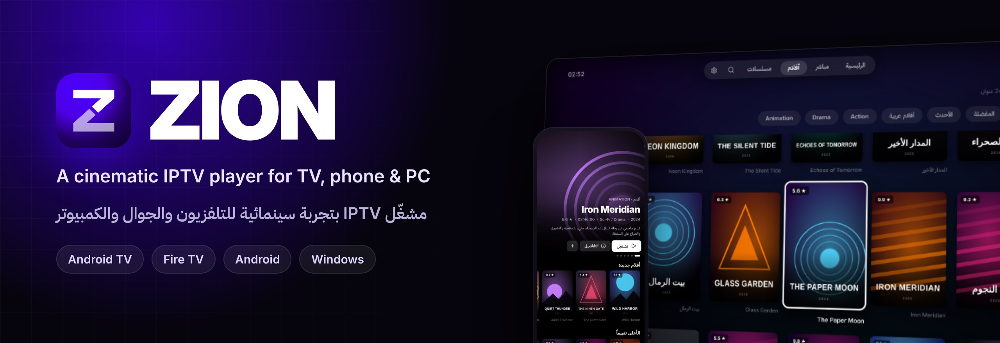
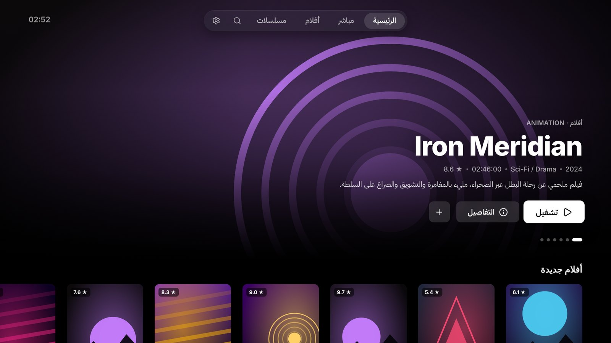
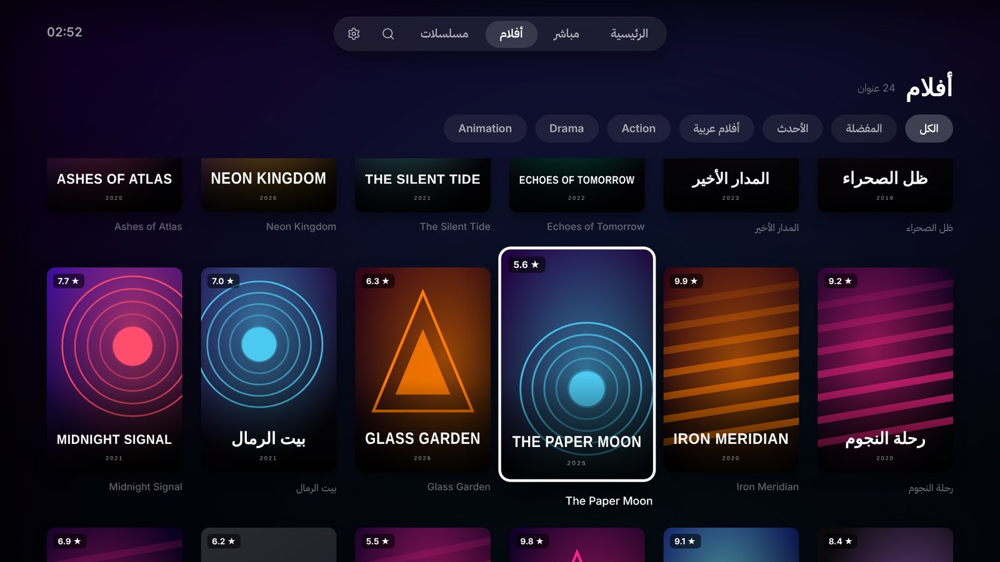
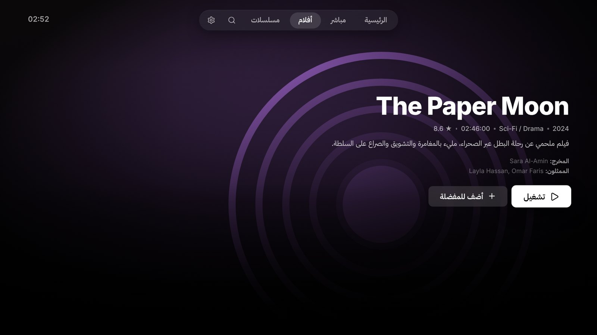
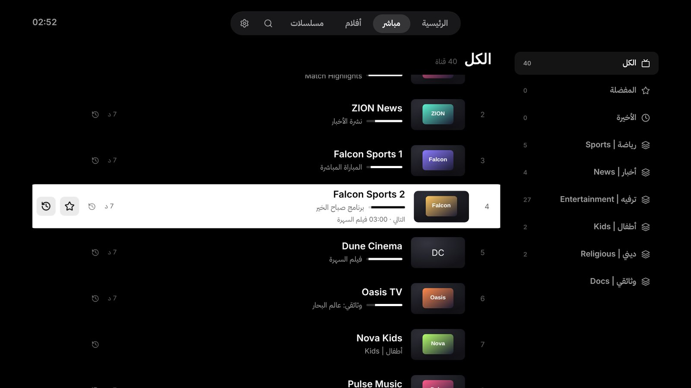
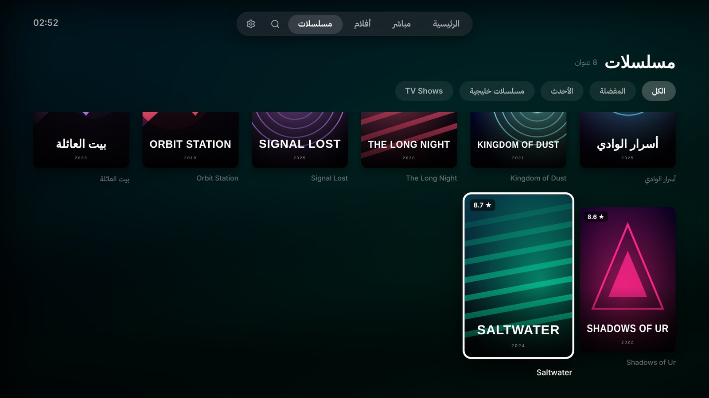
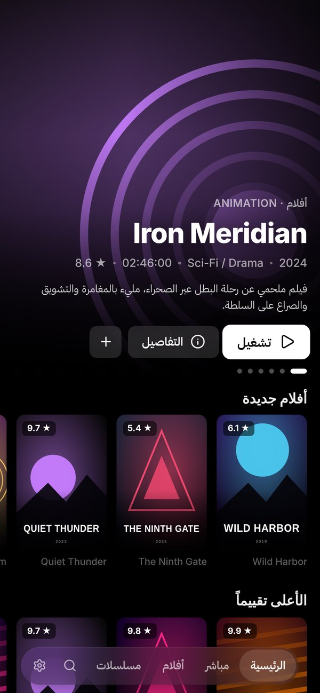
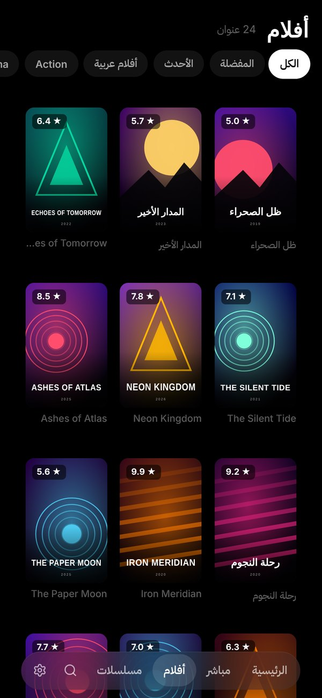
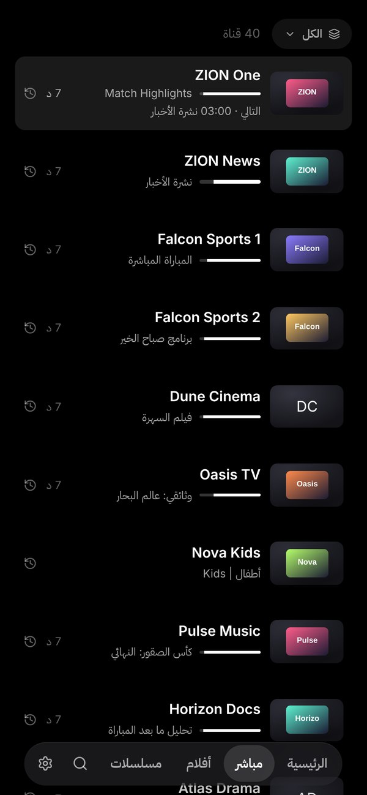
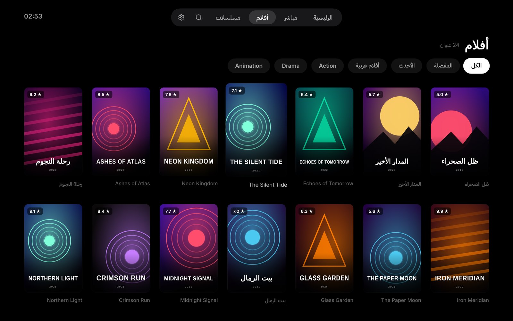

  

  
  
  

  <b>English</b> · <a href="#عربي">العربية</a>

---

## Download

Always the latest version. Once installed, ZION updates itself from inside the app.

  
  
  

  
  

## One app, every screen

  

<table>
  <tr>
    <td width="50%"></td>
    <td width="50%"></td>
  </tr>
  <tr>
    <td width="50%"></td>
    <td width="50%"></td>
  </tr>
</table>

  
  &nbsp;
  
  &nbsp;
  

  

Screenshots use demo data. Titles, posters and channel names are made up.

## Features

**Watch**
- Live TV with a full TV guide (EPG), now and next info, and favourite channels
- Catch-up: rewind live channels and play earlier programmes when your provider supports it
- Recording, either right now or scheduled until the programme ends
- Movies and series with seasons, episodes, Continue Watching and Start Over
- High-quality posters and backdrops from TMDB (optional)

**Player**
- Hardware decoding with an FFmpeg fallback for HEVC, AC3, DTS and other difficult streams
- Audio track, subtitle, video quality and aspect ratio selection
- Auto-reconnect when a stream drops, with buffering presets for slow connections
- Frame-rate matching on Android TV, plus an optional stream info overlay
- Open any stream in VLC or mpv when you need to

**Comfort**
- Designed for the TV remote, and works just as well with touch on a phone or a mouse on PC
- Add your subscription from your phone: scan the QR code shown on the TV and type it there
- Arabic and English, with right-to-left layout
- Parental control with PIN-locked categories
- In-app updates: one tap and you're on the latest version

**Sources:** Xtream Codes and M3U / M3U8 playlists, with XMLTV guides.

## Install

| Device | How |
|---|---|
| **Android TV / Google TV** | Install the **Downloader** app, open the APK link above, and allow installing from unknown sources when asked. |
| **Fire TV Stick** | *Settings → My Fire TV → Developer options → Install unknown apps → Downloader → On*, then open the **Fire TV Stick** APK link in Downloader. |
| **Android phone** | Download the APK and open it. Allow installing from your browser when asked. |
| **Windows 10 / 11** | Run **ZION-Setup.exe**. If SmartScreen appears, choose *More info → Run anyway*. Or use the **Portable EXE**, which needs no install. |

> [!NOTE]
> ZION is a player only. It does not include, sell or provide any channels, movies or subscriptions.
> You need your own IPTV subscription from a provider, and you are responsible for the content you load into it.

---

<h2 id="عربي">عربي</h2>

**ZION** مشغّل IPTV بتجربة سينمائية للتلفزيون والجوال والكمبيوتر. تطبيق واحد بنفس الشكل على كل الشاشات.

### التحميل

الروابط فوق تنزّل دايم آخر نسخة. بعد ما تثبّت التطبيق، يتحدّث بنفسه من داخله.

- **تلفزيون Android TV / Google TV، وجوال أندرويد:** ملف `ZION-universal.apk`
- **Fire TV Stick والأجهزة القديمة:** ملف `ZION-armv7-FireStick.apk`
- **ويندوز:** ملف `ZION-Setup.exe` للتثبيت، أو `ZION-Portable.exe` يشتغل بدون تثبيت

### المميزات

**المشاهدة**
- قنوات مباشرة مع دليل برامج كامل (EPG)، ووش يعرض الحين ووش بعده، وقنوات مفضلة
- الإعادة (Catch-up): ترجع للبرامج اللي فاتتك إذا كان مزوّدك يدعمها
- تسجيل البث، فوري أو مجدول لين نهاية البرنامج
- أفلام ومسلسلات بالمواسم والحلقات، مع "تابع المشاهدة" و"من البداية"
- بوسترات وخلفيات عالية الجودة من TMDB (اختياري)

**المشغّل**
- فك تشفير بالهاردوير، مع FFmpeg احتياطي للصيغ الصعبة مثل HEVC و AC3 و DTS
- اختيار الصوت والترجمة والجودة ومقاس العرض
- يرجّع البث لحاله إذا انقطع، مع إعدادات للتخزين المؤقت تناسب النت الضعيف
- مطابقة معدل الإطارات في Android TV، وعرض معلومات البث إذا تبغاها
- تفتح أي قناة في VLC أو mpv إذا احتجت

**الراحة**
- مصمم للريموت، ويشتغل بنفس السلاسة باللمس في الجوال وبالماوس في الكمبيوتر
- تضيف اشتراكك من جوالك: امسح الباركود اللي يطلع على الشاشة واكتب بياناتك فيه
- عربي وإنجليزي، مع اتجاه من اليمين لليسار
- رقابة أبوية: تقفل تصنيفات معينة برمز PIN
- تحديث من داخل التطبيق بضغطة وحدة

**المصادر:** Xtream Codes وروابط M3U / M3U8، مع دليل البرامج XMLTV.

### طريقة التثبيت

- **Android TV:** نزّل تطبيق **Downloader**، افتح فيه رابط الـ APK، ووافق على التثبيت من مصادر غير معروفة لما يطلب منك.
- **Fire TV Stick:** فعّل الخيار من *الإعدادات ← My Fire TV ← خيارات المطور ← تثبيت التطبيقات غير المعروفة ← Downloader*، وبعدين افتح رابط نسخة الفاير ستيك في Downloader.
- **الجوال:** نزّل الـ APK وافتحه، ووافق على التثبيت من المتصفح لما يطلب منك.
- **ويندوز:** شغّل `ZION-Setup.exe`. إذا طلعت لك نافذة SmartScreen، اختر *More info ← Run anyway*.

> **تنبيه:** ZION مشغّل فقط. ما يحتوي ولا يبيع ولا يوفّر أي قنوات أو أفلام أو اشتراكات. تحتاج اشتراك IPTV خاص فيك من مزوّد، وأنت المسؤول عن المحتوى اللي تضيفه.

الصور فيها بيانات تجريبية: أسماء الأفلام والبوسترات والقنوات كلها وهمية.

